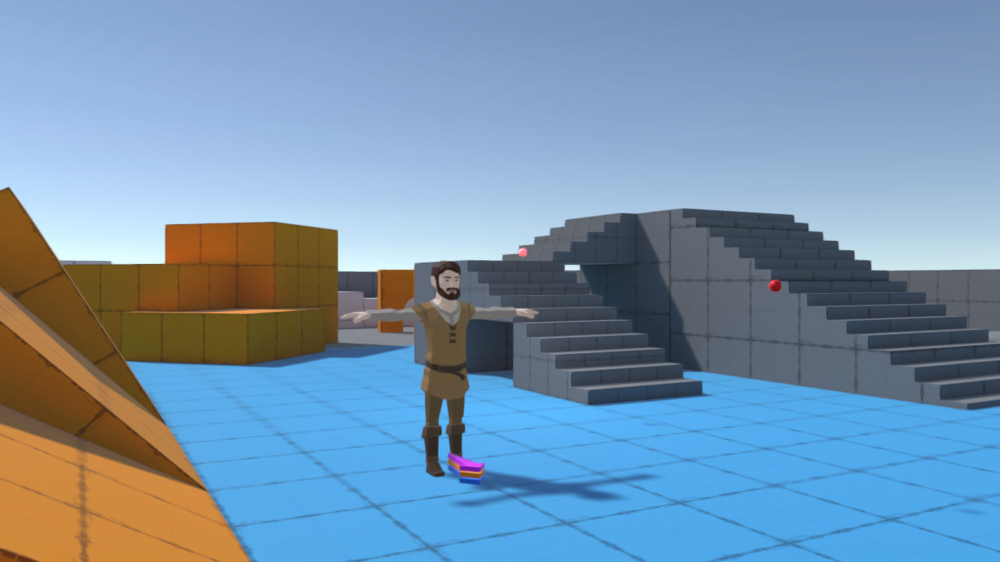
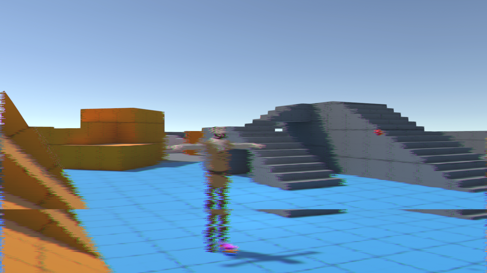
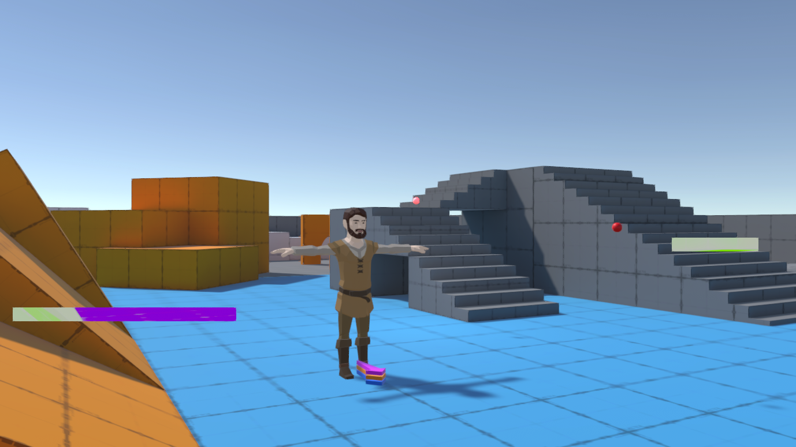
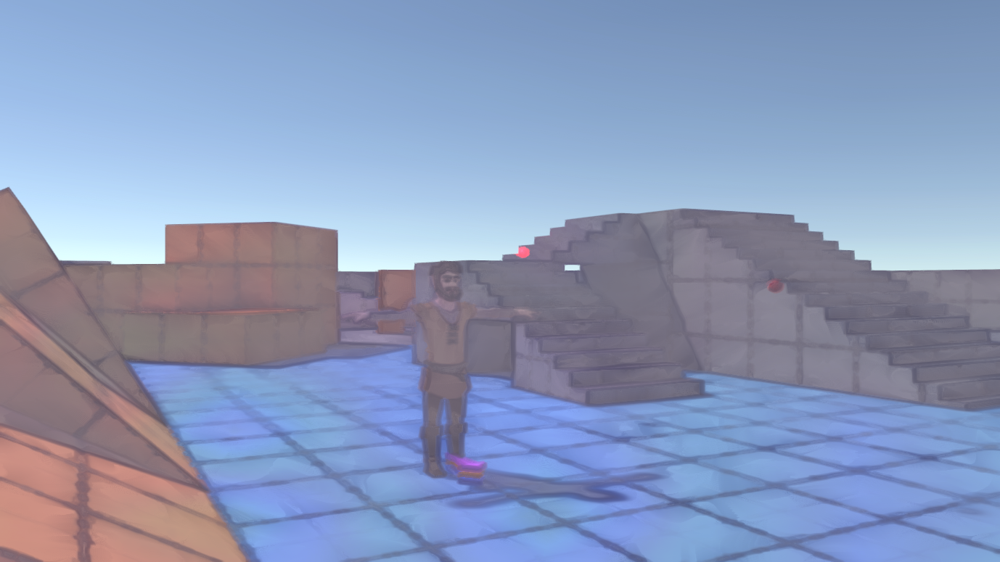
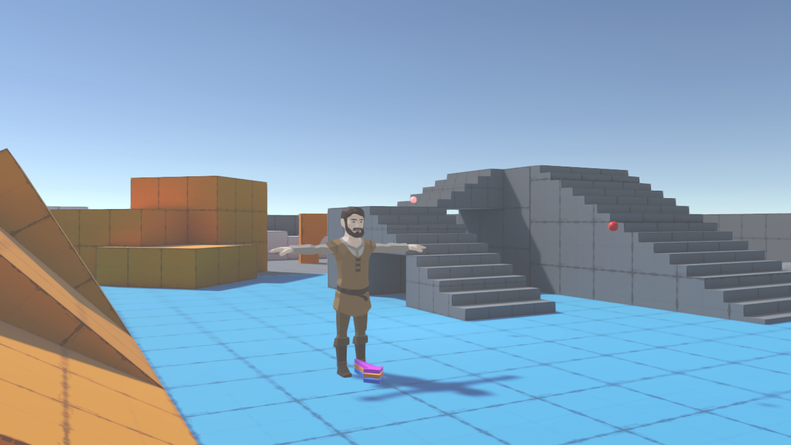
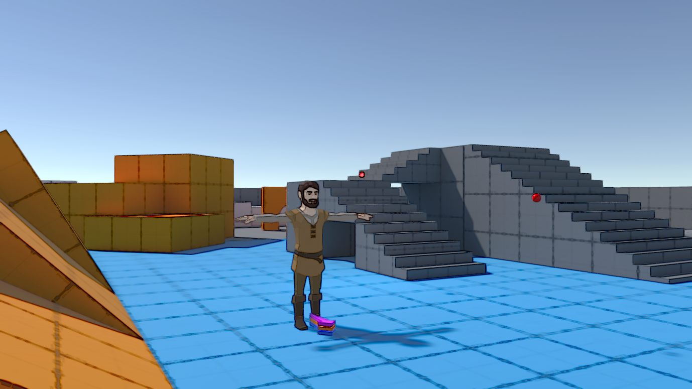
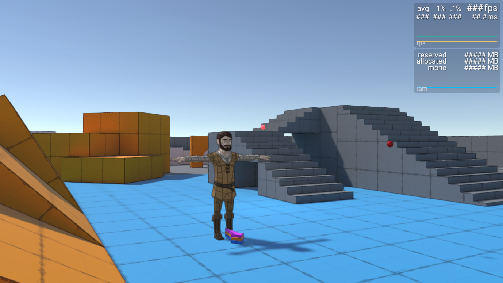
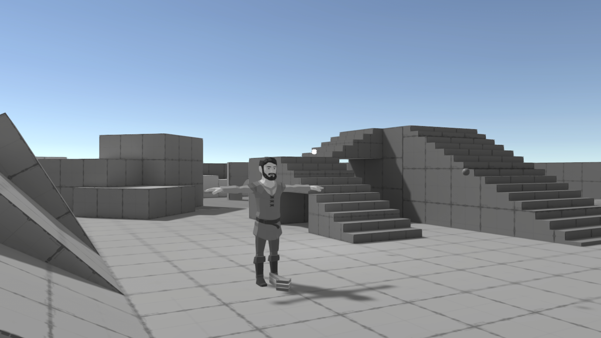
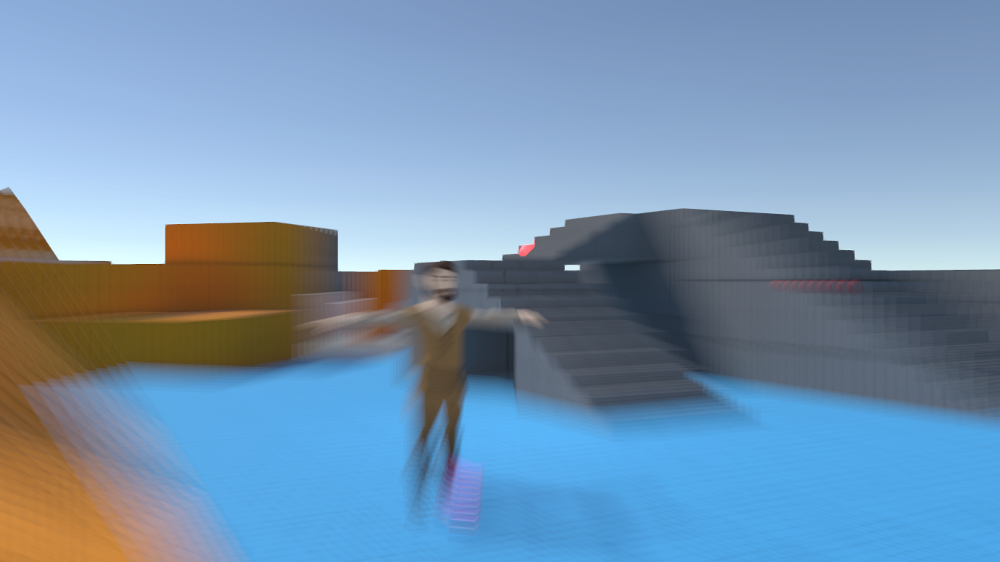

# PostProcessingURP

Custom post-processing effects integrated into **Unity 6 / URP 17 RenderGraph**.
The old `Execute`/temporary-RT backend has been replaced with explicit raster and compute graph passes.

## Requirements and setup

- Target: Unity 6.0 (6000.0) with URP 17, Universal Renderer (Forward or Deferred).
  Unity 2022 and Compatibility Mode are no longer supported by this branch.
- Copy this repository into `Assets/PostProcessingURP` (retain `.meta` files). This is not a standalone Unity project or a UPM package.
- In **Project Settings > Graphics > URP > Render Graph**, turn **Compatibility Mode (Render Graph Disabled)** off.
- Add the desired `...RenderFeature` to the active Universal Renderer Data asset.
- Enable **Post Processing** on the camera, then add the matching **Post-processing Custom/...** override to a Volume Profile.
  Check the desired parameter overrides. Existing Volume field names, Feature classes, and asset GUIDs are retained.
- New Features default to **BeforeRenderingPostProcessing**. Existing serialized injection events are kept, so review old renderer assets.
- WaterColor loads `Resources/Textures/WaterColorNoise` when its texture field is unassigned.
  GrayscaleCS loads its included compute asset automatically, with a raster fallback for unavailable compute/UAV support.
- Scene View rendering is optional. Overlay cameras are excluded by default to avoid double processing; enable
  **Affect Overlay Cameras** when intentionally processing each camera in a stack.

This migration has offline source/math checks, **not a recorded successful Unity Editor/Player or GPU validation run**.
Run **Tools > PostProcessingURP > Check Imported Shaders**, then perform the visual checks in `Tests/README.md`.
XR texture-array paths and per-eye shader sampling are implemented but require hardware validation.
Hardware dynamic resolution and foveated rendering also require target-device checks.

## Data flow

`Volume -> RendererFeature -> RecordRenderGraph -> raster/compute passes -> new camera color`

The common graph helper declares source, auxiliary, depth and normal dependencies explicitly.
Each effect records a parameter snapshot; render callbacks do not read a live Volume stack.
Raster shaders use the SRP full-screen triangle, source-aware texel sizes and texture-array sampling.
No unsafe pass or legacy `CommandBuffer.Blit` wrapper is used.

Most final-camera effects hand their result to `UniversalResourceData.cameraColor` without copying it back.
Early injection points and non-final cameras copy the completed effect back to the original shared/MSAA attachment,
so subsequent geometry and camera-stack rendering keep compatible targets. No pass samples its own attachment.

### Custom named buffers

The existing Source/Destination selectors remain. A **Custom** destination publishes a `TextureHandle` to
`PostProcessingFrameTextures`, a frame-data `ContextItem`. A later feature can use the same name as its Custom source.
The producer must run first (injection event, then renderer-feature order). A missing input warns and skips.

These names are **camera-local RenderGraph connections**, not persistent textures or implicit global shader properties.
They reset between camera graphs. An unconsumed custom output may be culled normally.
External integrations can set/read `frameData.GetOrCreate<PostProcessingFrameTextures>()` from their own graph-recording code.
Do not retain these handles across frames or camera graphs. For an external RenderTexture, import it in the same graph first.

### Resource lifetime and effect details

- RenderGraph owns all transient buffers (including Streak mip levels and multi-pass intermediates).
- DigitalGlitch imports separately owned histories per camera. First use and descriptor changes initialize both histories;
  destroyed/stale cameras and Feature disposal release the owned RTHandles and noise textures.
- Clarity2 weights sampled colors rather than UV coordinates, normalizes its kernels, and explicitly resets exclusive keywords.
- GrayscaleCS uses kernel group sizes, bounds checks and linear floating-point outputs, including an array kernel.
- Depth/normal requirements are declared before URP schedules its input passes. Normals use URP's decoder.
- HDR/alpha are retained where appropriate. FakeHDR, Clarity2 blend modes and other artistic operations still intentionally transform values;
  this is not a claim that all effects are physically based or exposure-invariant.
- OilPaint and WaterColor remain expensive sampling filters. This migration does not claim improved GPU timings.
- `ADOF` is an unfinished placeholder from the original repository. Its Feature is deliberately inactive rather than pretending to implement DoF.
- Legacy custom Volume inspectors still contain their original enable initialization behavior; code-created profiles should explicitly set
  their effect's `enable.value` and `enable.overrideState` to `true`. This migration does not change serialized Volume defaults.

## Validation

```text
python Tests/validate_sources.py
```

These are source-contract and mathematical regression checks only. See `Tests/README.md` for image, HDR, MSAA, stack, build and XR checks.

## References

- [Unity: render graph system](https://docs.unity3d.com/6000.0/Documentation/Manual/urp/render-graph.html)
- [Unity: render graph blits and camera-color handoff](https://docs.unity3d.com/6000.0/Documentation/Manual/urp/render-graph-blit.html)
- [Unity Graphics source (6000.0/staging)](https://github.com/Unity-Technologies/Graphics/tree/6000.0/staging)

## Effect gallery and upstream sources

The following screenshots are from the original implementation, **not validation images from the RenderGraph migration**.

Original screenshot without an effect:


### Kino: [upstream](https://github.com/keijiro)

<details><summary>Screenshots</summary>

| Effect | Screenshot |
|---|---|
| Analog Glitch |  |
| Contour |  |
| Digital Glitch |  |
| Streak |  |
| Watercolor |  |

</details>

### ReShade: [upstream](https://github.com/crosire/reshade-shaders)

<details><summary>Screenshots</summary>

| Effect | Screenshot |
|---|---|
| Adaptive Fog |  |
| Adaptive Sharpen |  |
| Cartoon |  |
| Clarity2 |  |
| Fake HDR |  |

</details>

### ShadersLab and others: [upstream](http://www.shaderslab.com)

<details><summary>Screenshots</summary>

| Effect | Screenshot |
|---|---|
| Edge Detection |  |
| Grayscale |  |
| GrayscaleCS (compute shader) |  |
| Oil Paint |  |
| Pencil |  |
| Radial Blur |  |

</details>
